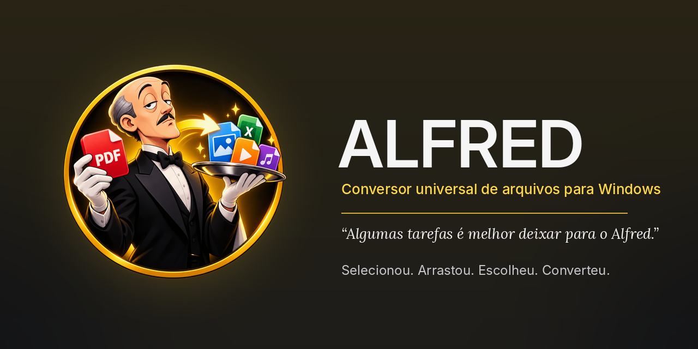
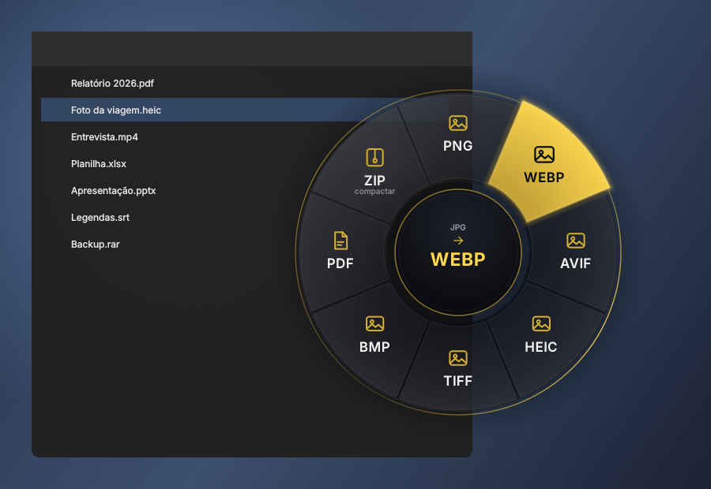
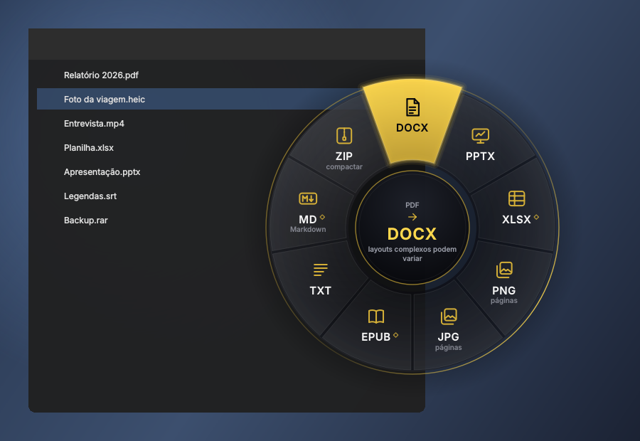

<p align="center">
  
</p>

<h1 align="center">ALFRED</h1>
<p align="center"><b>Conversor universal de arquivos para Windows 10 e 11</b><br>
<i>“Algumas tarefas é melhor deixar para o Alfred.”</i></p>

<p align="center">
  <a href="../../releases/latest">⬇️ Baixar para Windows</a> ·
  <a href="docs/COMPATIBILIDADE.md">Formatos suportados</a> ·
  <a href="https://www.youtube.com/@ilgn3r">Canal do desenvolvedor</a>
</p>

---

**Selecionou. Arrastou. Escolheu. Converteu.**

No Explorador de Arquivos, comece a arrastar um ou vários arquivos segurando **Shift**: uma roda de
conversão aparece ao lado do cursor, mostrando só os formatos que fazem sentido para aquele arquivo.
Solte sobre o formato desejado e pronto: o arquivo convertido aparece na pasta que você escolheu,
sem tocar no original.

Tudo acontece **no seu computador**. Nenhum arquivo é enviado para a internet.

<p align="center">
  
  
</p>
<p align="center">
  
</p>

## Recursos

- **Roda de conversão** circular, translúcida, sem janela quadrada atrás, com miniatura do arquivo no
  centro, animações curtas e sons originais. Funciona com o mouse, com o teclado (setas, Enter, 1–9) e
  como alvo do próprio arrastar do Windows.
- **Esc cancela na hora.** Soltar fora da roda também cancela: nada é convertido, copiado ou movido.
- **O original nunca é alterado nem sobrescrito.** Se já existir `foto.png`, o Alfred cria `foto (2).png`.
  Conversões que falham ou são canceladas não deixam arquivos pela metade.
- **Mais de 400 combinações** entre imagens, áudio, vídeo, PDF, documentos, apresentações, planilhas,
  legendas e arquivos compactados. Veja a [matriz completa](docs/COMPATIBILIDADE.md).
- **Motores incluídos no instalador**: FFmpeg, Pandoc, 7-Zip e (na edição Completa) LibreOffice.
  Não precisa instalar Python, configurar PATH nem abrir terminal.
- **Fica na bandeja**: fechar a janela no X mantém o Alfred pronto para o gesto. Só “Sair” encerra.
- **Menu de contexto** “Converter com Alfred” e atalho em **Enviar para**.
- **Histórico**, fila de conversões com progresso e cancelamento, notificações discretas.
- **Configurações** de destino, qualidade, sons (volume 0–100 % com pré-visualização), gesto e
  inicialização com o Windows — tudo salvo automaticamente.

## Download e instalação

1. Abra a página de [**Releases**](../../releases/latest).
2. Baixe um dos instaladores:
   - `Alfred_Setup_<versão>_Completa_x64.exe` — **recomendado**. Inclui o LibreOffice (DOC, DOCX → PDF,
     PPT, XLS, ODF…).
   - `Alfred_Setup_<versão>_Leve_x64.exe` — bem menor, sem LibreOffice. As conversões de Office que
     dependem dele só aparecem na roda se você já tiver o LibreOffice instalado.
3. Execute o instalador e siga o assistente. Ele cria o atalho no menu Iniciar, oferece o atalho na área de
   trabalho, a inicialização com o Windows, o gesto no Explorer, o menu de contexto e o “Enviar para”.
4. Abra o **Alfred** e use.

> **Aviso do SmartScreen:** enquanto o instalador não for assinado digitalmente, o Windows pode exibir
> “O Windows protegeu o computador”. Confira se o arquivo veio da página oficial de Releases e clique em
> *Mais informações → Executar assim mesmo*. O arquivo `SHA256SUMS.txt` de cada Release permite conferir
> a integridade do download.

**Requisitos:** Windows 10 (1809 ou mais recente) ou Windows 11, 64 bits. Não requer permissões de
administrador: a instalação é feita só para o seu usuário.

## Como usar

| Onde | Como |
|---|---|
| Explorador de Arquivos | Selecione os arquivos e **arraste segurando Shift**. Solte sobre o formato. |
| Explorador de Arquivos | Clique direito → **Converter com Alfred** (no Windows 11, em *Mostrar mais opções*). |
| Explorador de Arquivos | Clique direito → **Enviar para → Alfred**. |
| Janela do Alfred | Arraste arquivos para a área dourada ou clique em **Escolher arquivos**. |
| Com a roda aberta | **Esc** cancela · **setas** navegam · **Enter** confirma · **1–9** escolhem direto. |

Você pode trocar o gesto por **Shift + Ctrl + arrastar** ou **Shift + Alt + arrastar** em
*Configurações*, ou desativá-lo pelo ícone da bandeja.

> **Importante:** com o gesto “Shift + arrastar” ativo, segurar Shift durante um arrasto no Explorer
> abre a roda em vez de mover os arquivos. Para mover arquivos com Shift, desative o gesto na bandeja ou
> escolha outra combinação de teclas.

## Formatos

| Categoria | Entrada | Saídas principais |
|---|---|---|
| Imagens | JPG, PNG, WebP, HEIC, TIFF, AVIF, BMP, SVG | JPG, PNG, WebP, HEIC, AVIF, TIFF, BMP, PDF, PDF único (várias imagens) |
| Áudio | MP3, M4A, AAC, WAV, FLAC, OGG, Opus, AIFF, WMA | MP3, M4A, WAV, FLAC, OGG, Opus, AIFF, WMA |
| Vídeo | MP4, MOV, MKV, WebM, AVI, WMV, GIF | MP4, MOV, MKV, WebM, AVI, WMV, GIF, MP3 (só áudio) |
| PDF | PDF | DOCX, PPTX, XLSX, JPG/PNG (todas as páginas, 300 DPI), EPUB, TXT, Markdown |
| Documentos | DOC, DOCX, ODT, RTF, TXT, MD, HTML, EPUB | PDF, DOCX, DOC, ODT, RTF, TXT, MD, HTML, EPUB |
| Apresentações | PPT, PPTX, ODP | PDF, PPTX, PPT, ODP, JPG/PNG por slide |
| Planilhas | XLS, XLSX, ODS, CSV, TSV | XLSX, XLS, ODS, CSV, TSV, PDF |
| Legendas | SRT, VTT | SRT, VTT, TXT |
| Compactados | ZIP, TAR, GZ/TGZ, BZ2, XZ, RAR, 7Z | Extrair aqui, converter para ZIP |
| Qualquer coisa | arquivos e pastas | Compactar em ZIP |

Detalhes, motores, conversões experimentais e o que **não** é oferecido (e por quê) estão na
[matriz de compatibilidade](docs/COMPATIBILIDADE.md). O Alfred nunca “converte” renomeando extensões:
cada rota tem um motor real e um teste automatizado que valida o arquivo gerado.

## Para desenvolvedores

```powershell
git clone https://github.com/<você>/alfred.git
cd alfred
py -3.12 -m venv .venv
.venv\Scripts\pip install -r requirements-dev.txt
$env:PYTHONPATH = "src"
.venv\Scripts\python -m alfred          # abre o Alfred a partir do código
.venv\Scripts\python -m pytest -q       # roda os testes
```

- Build completo (executável sem console + instalador): `build_windows.bat` — veja [docs/BUILD.md](docs/BUILD.md).
- Publicar uma versão no GitHub: [docs/RELEASE.md](docs/RELEASE.md).
- Arquitetura e decisões técnicas (incluindo como o gesto funciona): [docs/ARQUITETURA.md](docs/ARQUITETURA.md).
- O que foi testado, como e o que ainda precisa de teste manual: [docs/TESTES.md](docs/TESTES.md).
- Diagnóstico da versão 1.x e o que mudou: [docs/DIAGNOSTICO_V1.md](docs/DIAGNOSTICO_V1.md) e [CHANGELOG.md](CHANGELOG.md).

```
src/alfred/
  core/          conversão (sem interface): motores, rotas, fila, histórico, configurações
    converters/  imagens, mídia, PDF, documentos/planilhas/apresentações, legendas, compactados
  platform/      Windows: gesto Shift+arrastar, instância única, registro, Win32
  ui/            PySide6: janela, roda radial, notificações, bandeja, sons, ícones, tema
packaging/       PyInstaller (.spec) e Inno Setup (.iss)
tools/           build, motores, arte, sons, matriz, autoteste do instalador
tests/           ~600 testes automatizados
```

## Licença, venda e direitos

- **Código:** [GNU AGPL-3.0-or-later](LICENSE). Você pode distribuir o Alfred **de graça ou vendê-lo**
  (por exemplo, por um preço acessível com suporte ou instalador pronto), desde que quem recebe o programa
  também tenha acesso ao código-fonte sob a mesma licença. Detalhes em
  [docs/LICENCA_E_VENDA.md](docs/LICENCA_E_VENDA.md).
- **Logotipo e personagem:** não fazem parte da AGPL. Veja [docs/ASSETS_E_DIREITOS.md](docs/ASSETS_E_DIREITOS.md).
- **Componentes de terceiros:** [THIRD_PARTY_NOTICES.md](THIRD_PARTY_NOTICES.md).

Projeto independente, sem afiliação com DC Comics, Warner Bros. ou qualquer outra marca.

## Apoie o projeto

O Alfred é gratuito, sem anúncios e offline. Se ele te ajuda no dia a dia, considere um Pix de qualquer valor
(também disponível em *Configurações › Apoie o projeto* dentro do app):

<p align="center"></p>

Pix copia e cola:

```
00020126580014BR.GOV.BCB.PIX0136596a3240-f616-4b82-b066-18bcae3ac6645204000053039865802BR5906ilgn3r6006CIDADE62070503***63046B6B
```

## Créditos

Criado por **[@ilgn3r](https://www.youtube.com/@ilgn3r)**. Contribuições são bem-vindas — leia o
[CONTRIBUTING.md](CONTRIBUTING.md). Encontrou uma falha de segurança? Veja o [SECURITY.md](SECURITY.md).
